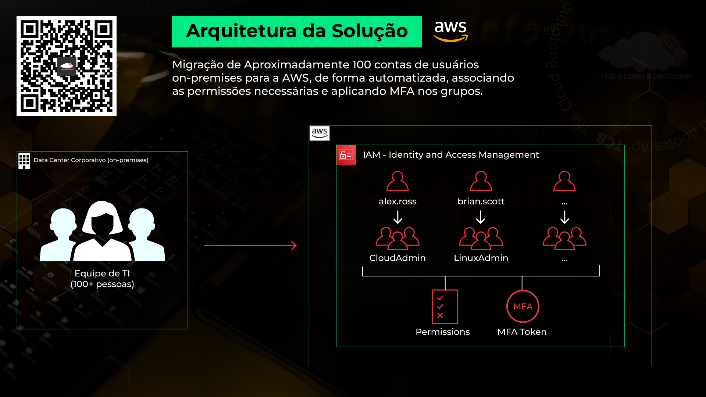
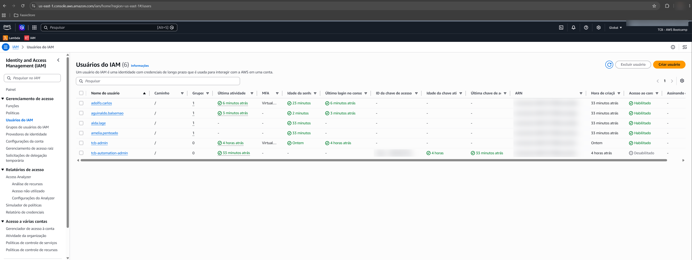

# HandsOn 1 – Migração automatizada de usuários para o AWS IAM com MFA


## Cenário

Neste projeto, baseado em um cenário real, atuei como Especialista Cloud. A tarefa era migrar cerca de 100 contas de usuários de um data center corporativo (on-premises) para o **AWS IAM (Identity and Access Management)**. Cada usuário precisava entrar no grupo certo, com as permissões da sua função, e ter o **MFA (Multi-Factor Authentication, autenticação por múltiplos fatores)** obrigatório, que é uma boa prática de segurança.

Criar 100 usuários um a um no console da AWS seria uma tarefa repetitiva, lenta e sujeita a erro. Por isso, a solução foi pensada desde o início para ser **automatizada**.

## Arquitetura da solução



1. A lista de usuários sai do ambiente on-premises em um arquivo CSV (`usuario;grupo;senha`).
2. Um Shell Script lê o CSV e, para cada linha, usa a AWS CLI para:
   - criar o usuário no IAM;
   - criar o perfil de login com senha temporária e troca obrigatória no primeiro acesso;
   - adicionar o usuário ao grupo correspondente (ex.: `CloudAdmin`, `LinuxAdmin`, `DBA`, `RedesAdmin`).
3. As permissões ficam nos **grupos**, não nos usuários. Isso facilita a gestão: quem muda de função muda de grupo.
4. Uma política IAM aplicada aos grupos **bloqueia qualquer ação até o usuário configurar o MFA**. Sem MFA, ele só consegue trocar a senha e cadastrar o próprio dispositivo.

## Serviços e tecnologias

- **AWS IAM**: usuários, grupos e políticas
- **AWS CLI**: automação dos comandos do IAM
- **Shell Script (Bash)**: leitura do CSV e laço de criação
- **Git Bash**: terminal usado no Windows

## Arquivos

| Arquivo | O que faz |
|---|---|
| [`scripts/aws-iam-cria-usuario.sh`](scripts/aws-iam-cria-usuario.sh) | Lê o CSV e cria usuário, login e vínculo com o grupo |
| [`scripts/force_mfa_policy.json`](scripts/force_mfa_policy.json) | Política que nega tudo enquanto o MFA não estiver ativo |
| [`scripts/usuarios-exemplo.csv`](scripts/usuarios-exemplo.csv) | Modelo do arquivo de entrada (sem senhas reais) |

Execução:

```bash
./aws-iam-cria-usuario.sh usuarios.csv
```

## Resultado

Usuários criados pelo script e vinculados aos grupos, com login no console habilitado e MFA virtual ativo após o primeiro acesso:



> ID da conta, ARNs e chave de acesso foram borrados na imagem. Versão em PDF: [`console-usuarios-iam.pdf`](imagens/console-usuarios-iam.pdf).

## O que aprendi

- Pensar em automação desde o início: o mesmo script que cria 4 usuários cria 100.
- Gerenciar permissões por grupo é mais seguro e mais simples de manter do que por usuário.
- Com políticas IAM e a condição `aws:MultiFactorAuthPresent`, dá para tornar o MFA obrigatório em vez de só recomendado.
- Senha temporária com troca obrigatória no primeiro login evita que a senha inicial continue em uso.

---

Projeto desenvolvido no AWS Bootcamp da The Cloud Bootcamp. Script base fornecido pelo instrutor Jean Rodrigues.
